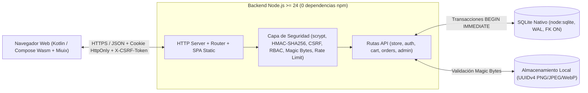

# TBD.SUPPLY

**Hardware, Drip & Objetos con Criterio** — Tienda web full-stack con interfaz nativa compilada a **WebAssembly (Kotlin / Compose Multiplatform + Miuix)** y backend **Node.js (>= 24) + SQLite** construido desde cero con **cero dependencias npm de terceros**.

[](https://github.com/xUsoCarrusoX3/TBD-Supply/actions/workflows/ci.yml)
[](LICENSE)
[](https://nodejs.org/)
[](https://kotlinlang.org/docs/wasm-overview.html)
[](https://nodejs.org/api/sqlite.html)
[](#arquitectura-y-stack-técnico)

> Proyecto creativo de ingeniería desarrollado y presentado por **Enrique**, **Edgarvis**, **Leonel**, **Aníbal** y **Jhoynner**.

---

## Tabla de Contenidos

- [¿Qué es TBD.SUPPLY?](#qué-es-tbdsupply)
- [Características Principales](#características-principales)
- [Arquitectura y Stack Técnico](#arquitectura-y-stack-técnico)
- [Estructura del Proyecto](#estructura-del-proyecto)
- [Inicio Rápido (1 Clic)](#inicio-rápido-1-clic)
- [Desarrollo Manual](#desarrollo-manual)
- [Configuración y Variables de Entorno](#configuración-y-variables-de-entorno)
- [Referencia de la API REST](#referencia-de-la-api-rest)
- [Esquema de Base de Datos](#esquema-de-base-de-datos)
- [Seguridad Implementada desde Cero](#seguridad-implementada-desde-cero)
- [Pruebas Automatizadas](#pruebas-automatizadas)
- [Contribución y Gobernanza](#contribución-y-gobernanza)
- [Equipo y Licencia](#equipo-y-licencia)

---

## ¿Qué es TBD.SUPPLY?

**TBD.SUPPLY** es una **tienda web en línea completa (*e-commerce*)** pensada para **publicar, administrar y vender objetos** de forma directa desde el navegador, combinando una experiencia visual fluida para compradores con un **panel de administrador integrado**.

### ¿Qué se puede hacer en la aplicación?

- **Comprar como cliente:**
  - Explorar el catálogo de objetos disponibles, buscar artículos, filtrarlos por categoría o curador y ordenarlos por precio, novedad o stock.
  - Abrir el detalle de cualquier producto para ver su galería de imágenes, descripción, precio en **USD** y unidades disponibles.
  - Crear una cuenta, añadir artículos al **carrito de compras** y realizar pedidos con descuento automático de inventario y **recibo de confirmación** al instante.
  - Seguir el estado de cada orden y hablar directamente con el administrador desde el **chat integrado por pedido**, con soporte para enviar mensajes de texto y **subir imágenes** (por ejemplo, comprobantes o referencias).
- **Gestionar la tienda desde el Panel de Administrador:**
  - **Vender y publicar nuevos objetos** directamente desde la interfaz (sin editar código ni la base de datos): definir título, subtítulo, descripción, categoría, precio, precio tachado/oferta y stock.
  - **Colocar y administrar imágenes** en cada producto (`PNG`, `JPEG` y `WebP`), gestionar su galería, elegir la foto principal de portada y eliminar imágenes cuando haga falta.
  - **Crear y editar categorías** con nombre, descripción, color de acento y orden de aparición.
  - **Controlar pedidos y atender clientes:** revisar las compras recibidas, cambiar su estado (`Pendiente`, `Preparando`, `Enviado`, `Entregado` o `Cancelado`) y responder en el chat de cada pedido con texto o fotos.
  - **Administrar usuarios y seguridad:** consultar cuentas registradas, cambiar roles (`customer` / `admin`), desactivar cuentas, cerrar sesiones remotamente y auditar la actividad del sistema.

---

## Características Principales

### Experiencia de Tienda (Frontend WebAssembly)
- **Interfaz nativa con Miuix:** Renderizada mediante Kotlin / Compose Multiplatform (`wasmJs` + Skiko) usando la librería de diseño [Miuix](https://github.com/compose-miuix-ui/miuix).
- **Diseño adaptable:** Cambia dinámicamente entre barra inferior (`NavigationBar`, `< 840 dp`) para móviles y riel lateral (`NavigationRail`, expandible en `>= 1180 dp`) para escritorio.
- **Personalización visual en vivo:** Soporte para 6 modos de color (`System`, `Light`, `Dark`, `MonetSystem`, `MonetLight`, `MonetDark`), paleta de color clave y geometría *Squircle*.
- **Catálogo interactivo:** Búsqueda con escape seguro de comodines, filtrado por categoría y curador (`Enrique`, `Edgarvis`, `Leonel`, `Aníbal`), ordenamiento por fecha/precio/stock y vista detallada con galería de imágenes.
- **Carrito y checkout en USD:** Carrito persistente por usuario con fusión desde sesión invitada (`/api/cart/merge`), precios exactos en centavos enteros y recibo instantáneo con código único (`TBD-YYYY-XXXXXX`).
- **Chat directo por pedido:** Hilo de mensajería entre cliente y administrador dentro de cada orden, con soporte para mensajes de texto y adjuntos de imagen validados (`PNG`, `JPEG`, `WebP`).

### Panel de Administración y Operación
- **Dashboard con métricas:** Resumen operativo de catálogo, inventario, pedidos y actividad.
- **Gestión completa (CRUD):** Administración de categorías, productos, galería de imágenes (subida, imagen principal y eliminación), pedidos (cambio de estado: `pending` → `preparing` → `shipped` → `delivered` / `cancelled`), usuarios (roles, activación, revocación de sesiones) y consulta de `audit_logs`.
- **Arranque desatendido y túnel público:** Instalador automático en 1 clic para Windows y POSIX, con soporte integrado para exponer la app temporalmente mediante **Cloudflare Quick Tunnel**.

---

## Arquitectura y Stack Técnico



| Capa | Tecnología | Detalles |
| :--- | :--- | :--- |
| **Frontend** | Kotlin `2.4.21` + Compose Multiplatform `1.12.2` | Compilación `wasmJs` (`composeApp.js` + `.wasm`), `kotlinx-serialization` `1.13.0`, `kotlinx-collections-immutable` `0.5.2` |
| **Sistema de Diseño** | [Miuix](https://github.com/compose-miuix-ui/miuix) (`compose-miuix-ui`) | Integrado vía Gradle composite build en `vendor/miuix` (pin `d8efe187`) |
| **Backend** | Node.js `>= 24.0.0` (ESM) | 100 % módulos nativos (`node:http`, `node:sqlite`, `node:crypto`, `node:fs`, `node:path`, `node:zlib`) — **cero paquetes npm de terceros** |
| **Base de Datos** | SQLite (`node:sqlite` `DatabaseSync`) | Modo `WAL`, `PRAGMA foreign_keys = ON`, `busy_timeout = 5000`, `BEGIN IMMEDIATE` en checkout |
| **Pruebas** | `node:test` + `node:assert/strict` | Suites automatizadas de integración end-to-end y auditoría de seguridad |
| **CI/CD** | GitHub Actions | Ejecución automática de `npm test` en cada `push` y `pull_request` hacia `main` |

---

## Estructura del Proyecto

```text
TBD-Supply/
├── .github/
│   ├── ISSUE_TEMPLATE/          # Formularios YAML para bugs y propuestas
│   ├── workflows/ci.yml         # Pipeline CI de pruebas de integración y seguridad
│   └── PULL_REQUEST_TEMPLATE.md # Checklist estándar para Pull Requests
├── gradle/
│   ├── libs.versions.toml       # Catálogo centralizado de versiones Kotlin/Compose
│   └── wrapper/                 # Gradle Wrapper
├── scripts/
│   ├── bootstrap.ps1            # Instalador, compilador Wasm y lanzador Windows
│   ├── bootstrap.sh             # Instalador, compilador Wasm y lanzador Linux/macOS
│   └── seed-assets/             # Imágenes PNG semilla para el catálogo demo
├── server/
│   ├── src/
│   │   ├── db/                  # Conexión SQLite WAL, migraciones, semilla y assets PNG
│   │   ├── http/                # Enrutador propio y helpers de E/S HTTP seguros
│   │   ├── middleware/          # Sesión, CSRF/Same-Origin y control RBAC
│   │   ├── routes/              # store, auth, cart, orders y admin
│   │   ├── security/            # scrypt, sesiones, CSRF, cabeceras, upload, rate limit
│   │   ├── utils/               # Auditoría persistente (audit_logs) y hash de IP
│   │   ├── app.js               # Ensamblado HTTP, API y servicio de SPA/estáticos
│   │   ├── config.js            # Carga de .env y parámetros del servidor
│   │   └── index.js             # Arranque del servidor y cierre limpio (SIGINT/SIGTERM)
│   └── tests/
│       ├── integration.test.js  # Flujo integral de tienda, checkout y panel admin
│       └── security.test.js     # Auditoría automatizada contra vectores OWASP
├── webApp/
│   └── src/
│       ├── commonMain/kotlin/nose/
│       │   ├── model/           # DTOs serializables y formateo USD
│       │   ├── network/         # Cliente API y puente multiplataforma
│       │   ├── state/           # Gestión reactiva de estado (StoreAppState)
│       │   ├── ui/components/   # Hojas de producto, recibos y chat por pedido
│       │   ├── ui/screens/      # Tienda, Categorías, Carrito, Cuenta y Admin
│       │   └── App.kt           # Punto de entrada Compose + navegación adaptable
│       └── webMain/             # Bootstrap WebAssembly, puente JS y recursos estáticos
├── .editorconfig                # Reglas de formato multi-IDE
├── .env.example                 # Plantilla de variables de entorno
├── AGENTS.md                    # Contexto y reglas para agentes de IA
├── CHANGELOG.md                 # Registro de versiones (Keep a Changelog)
├── CONTRIBUTING.md              # Guía de contribución y Conventional Commits
├── LICENSE                      # Licencia MIT
├── SECURITY.md                  # Política de seguridad y endurecimiento en producción
├── iniciar.bat                  # Lanzador 1 clic para Windows
├── iniciar-publico.bat          # Lanzador Windows + Cloudflare Quick Tunnel
└── iniciar.sh                   # Lanzador 1 clic para Linux / macOS
```

---

## Inicio Rápido (1 Clic)

### Requisitos Previos
Los scripts de arranque detectan e instalan automáticamente las dependencias faltantes cuando es posible, pero los requisitos base son:
- **Node.js `>= 24.0.0`** (con soporte nativo `node:sqlite`)
- **JDK `21+`** (para compilar el frontend Kotlin/Compose Wasm con Gradle)
- **Git** (para clonar el motor UI en `vendor/miuix`)

### Windows
Haz doble clic en **`iniciar.bat`** o ejecútalo desde terminal:

```bat
iniciar.bat
```

El lanzador automático realiza todo el aprovisionamiento:
1. Verifica **Node.js (>= 24)**, **npm**, **JDK 21+** y **Git** (si falta alguno, solicita UAC para instalar vía `winget` con fallback oficial verificado por SHA-256 y refresca el `PATH`).
2. Inicializa `vendor/miuix` clonando `compose-miuix-ui/miuix` en el commit verificado (`d8efe187`).
3. Crea `.env` desde `.env.example` generando `SESSION_PEPPER` e `IP_HASH_SALT` criptográficos únicos si no existe.
4. Compila el frontend WebAssembly de Miuix en `server/dist-web/` y guarda un hash de fuentes (`.build-stamp`) para arranques posteriores en ~1 segundo.
5. Ejecuta migraciones SQLite, asegura la cuenta administrador inicial, espera a `/api/health` y abre el navegador en `http://127.0.0.1:3000`.

| Comando / Opción | Descripción |
| :--- | :--- |
| `iniciar-publico.bat` *(o `iniciar.bat -Tunnel`)* | Levanta el servidor local y abre un enlace público temporal con **Cloudflare Quick Tunnel** (`https://*.trycloudflare.com`), copiándolo al portapapeles. |
| `iniciar.bat -Rebuild` | Fuerza la recompilación limpia del frontend WebAssembly. |
| `iniciar.bat -BuildOnly` | Verifica entorno y compila el frontend sin levantar el servidor. |
| `iniciar.bat -CheckOnly` | Comprueba únicamente Node.js, Java y `vendor/miuix`. |
| `iniciar.bat -NoBrowser` | Inicia el servidor sin abrir el navegador automáticamente. |

### Linux / macOS
```bash
chmod +x iniciar.sh scripts/bootstrap.sh
./iniciar.sh
```

Opciones disponibles en POSIX:
- `./iniciar.sh --rebuild` — fuerza la recompilación del frontend Wasm.
- `./iniciar.sh --build-only` — compila el frontend y finaliza sin iniciar el servidor.
- `./iniciar.sh --no-browser` — levanta el servidor sin abrir navegador.
- `./iniciar.sh --tunnel` — habilita túnel público temporal con `cloudflared` (si está instalado).

---

## Desarrollo Manual

Si prefieres controlar cada paso desde la terminal sin los lanzadores automáticos:

```bash
# 1. Preparar variables de entorno
cp .env.example .env

# 2. (Opcional) Inicializar la base de datos y crear el admin inicial
npm run seed

# 3. Compilar el frontend WebAssembly (requiere vendor/miuix presente)
./gradlew :webApp:wasmJsBrowserDistribution -Prelease --no-configure-on-demand
cp -R webApp/build/dist/wasmJs/productionExecutable/. server/dist-web/

# 4. Iniciar el backend en modo desarrollo con recarga automática
npm run dev
```

### Scripts `npm` disponibles

| Script | Comando | Uso |
| :--- | :--- | :--- |
| `npm start` | `node server/src/index.js` | Inicia el servidor HTTP en modo normal |
| `npm run dev` | `node --watch server/src/index.js` | Inicia el servidor con reinicio automático al editar archivos |
| `npm run seed` | `node server/src/db/runSeed.js` | Aplica migraciones y prepara la cuenta admin / semilla |
| `npm test` | `node --test server/tests/integration.test.js server/tests/security.test.js` | Ejecuta toda la suite de integración y seguridad |
| `npm run test:security` | `node --test server/tests/security.test.js` | Ejecuta únicamente la batería de pruebas de seguridad |

---

## Configuración y Variables de Entorno

Todas las variables se leen desde `.env` (ver plantilla en [`.env.example`](.env.example)) o desde el entorno del sistema:

| Variable | Por defecto | Descripción |
| :--- | :--- | :--- |
| `PORT` | `3000` | Puerto de escucha del servidor HTTP (`0–65535`). |
| `HOST` | `127.0.0.1` | Interfaz de red de escucha. |
| `NODE_ENV` | `development` | Entorno de ejecución (`development` / `production`). |
| `DB_PATH` | `server/data/store.sqlite` | Ruta del archivo SQLite (relativa a la raíz o absoluta). |
| `UPLOAD_DIR` | `server/storage/uploads` | Directorio para imágenes de productos y adjuntos de chat. |
| `DIST_WEB_DIR` | `server/dist-web` | Directorio del bundle WebAssembly servido por Node.js. |
| `SESSION_PEPPER` | *(aleatorio si falta)* | Secreto HMAC-SHA256 de 32 bytes hex para hashear tokens de sesión. |
| `IP_HASH_SALT` | *(aleatorio si falta)* | Sal criptográfica para anonimizar direcciones IP en auditoría y rate limit. |
| `ADMIN_BOOTSTRAP_USER` | `admin` | Usuario inicial de la cuenta administradora. |
| `ADMIN_BOOTSTRAP_EMAIL` | `admin@tbdsupply.local` | Correo inicial de la cuenta administradora. |
| `ADMIN_BOOTSTRAP_PASSWORD` | *(clave aleatoria 20 chars)* | Contraseña del admin en arranque. Si se omite, se genera una efímera de 20 caracteres. |
| `ALLOWED_ORIGINS` | `""` | Lista separada por comas de orígenes permitidos adicionales para validación CSRF/Origin. |
| `TRUST_PROXY` | `false` | Activar (`true`) solo detrás de un reverse proxy confiable (`X-Forwarded-*`). |
| `COOKIE_SECURE` | `false` (`true` en `production`) | Marca la cookie de sesión con atributo `Secure` sobre conexiones HTTPS. |
| `LOCAL_AUTO_ADMIN` | `true` | Auto-inicia sesión admin en conexiones `localhost` directas sin proxy. **Establecer en `false` en producción.** |
| `SEED_DEMO_CATALOG` | `false` | Si es `true` y no existen categorías, carga las 4 categorías y 12 productos demo con sus imágenes PNG. |

---

## Referencia de la API REST

Todos los endpoints que modifican estado (`POST`, `PUT`, `PATCH`, `DELETE`) validan origen y, cuando existe sesión autenticada, requieren la cabecera `X-CSRF-Token`.

### Tienda y Salud
| Método | Ruta | Acceso | Descripción |
| :--- | :--- | :--- | :--- |
| `GET` | `/api/health` | Público | Verificación de estado (`{ "ok": true }`). |
| `GET` | `/api/categories` | Público | Lista categorías activas con conteo de productos. |
| `GET` | `/api/products` | Público | Catálogo paginado con filtros `q`, `category`, `founder`, `sort`, `page`, `limit`. |
| `GET` | `/api/products/:slug` | Público | Detalle completo de producto y galería de imágenes. |
| `GET` | `/api/media/:key` | Público | Entrega segura de imágenes de productos validadas (`sandbox` CSP). |

### Autenticación y Sesiones
| Método | Ruta | Acceso | Descripción |
| :--- | :--- | :--- | :--- |
| `GET` | `/api/auth/me` | Público | Retorna usuario autenticado y `csrfToken` activo. |
| `POST` | `/api/auth/register` | Público | Registro de cuenta cliente con creación de sesión. |
| `POST` | `/api/auth/login` | Público | Inicio de sesión por usuario o correo (protegido contra fuerza bruta). |
| `POST` | `/api/auth/logout` | Sesión | Revoca la sesión actual y limpia la cookie `tbd_sid`. |
| `POST` | `/api/auth/logout-all` | Usuario | Revoca todas las sesiones activas del usuario. |
| `POST` | `/api/auth/change-password` | Usuario | Cambia contraseña, revoca sesiones previas y emite una nueva sesión. |

### Carrito y Checkout
| Método | Ruta | Acceso | Descripción |
| :--- | :--- | :--- | :--- |
| `GET` | `/api/cart` | Usuario | Obtiene el carrito del usuario con subtotal y validación de stock. |
| `PUT` | `/api/cart/items/:productId` | Usuario | Define cantidad (`0` elimina el ítem; `1–99` valida disponibilidad). |
| `POST` | `/api/cart/merge` | Usuario | Fusiona ítems del carrito invitado con el carrito autenticado. |
| `POST` | `/api/checkout` | Usuario | Crea orden y descuenta stock atómicamente (`BEGIN IMMEDIATE`). |

### Pedidos y Chat con Adjuntos
| Método | Ruta | Acceso | Descripción |
| :--- | :--- | :--- | :--- |
| `GET` | `/api/orders` | Usuario | Historial de pedidos del usuario autenticado. |
| `GET` | `/api/orders/:orderCode` | Propietario / Admin | Detalle de la orden, ítems snapshot e historial de chat. |
| `GET` | `/api/orders/:orderCode/messages` | Propietario / Admin | Lista mensajes del hilo del pedido. |
| `POST` | `/api/orders/:orderCode/messages` | Propietario / Admin | Envía texto (`application/json`) o texto + imagen (`multipart/form-data`). |
| `GET` | `/api/orders/:orderCode/attachments/:key` | Propietario / Admin | Descarga segura de adjuntos del chat con protección anti-IDOR. |

### Panel de Administración (`/api/admin/*` — Solo rol `admin`)
| Recurso | Endpoints |
| :--- | :--- |
| **Dashboard** | `GET /api/admin/dashboard` |
| **Categorías** | `GET /api/admin/categories`, `POST /api/admin/categories`, `PATCH /api/admin/categories/:id`, `DELETE /api/admin/categories/:id` |
| **Productos** | `GET /api/admin/products`, `POST /api/admin/products`, `PATCH /api/admin/products/:id`, `DELETE /api/admin/products/:id` |
| **Imágenes** | `POST /api/admin/media`, `PATCH /api/admin/media/:id/primary`, `DELETE /api/admin/media/:id` |
| **Pedidos** | `GET /api/admin/orders`, `PATCH /api/admin/orders/:id/status`, `DELETE /api/admin/orders/:id` |
| **Usuarios** | `GET /api/admin/users`, `PATCH /api/admin/users/:id`, `POST /api/admin/users/:id/revoke-sessions`, `DELETE /api/admin/users/:id` |
| **Auditoría y BD** | `GET /api/admin/audit-logs`, `POST /api/admin/reset-db` |

---

## Esquema de Base de Datos

SQLite se ejecuta en modo `WAL` con integridad referencial estricta (`PRAGMA foreign_keys = ON`) y 10 tablas relacionales definidas en [`server/src/db/migrations.js`](server/src/db/migrations.js):

- **`users`**: Cuentas (`customer` / `admin`), hashes `scrypt`, estado y contadores de bloqueo por intentos fallidos.
- **`sessions`**: Hashes HMAC-SHA256 de tokens, `csrf_token`, hashes de User-Agent e IP, expiración y revocación.
- **`categories`**: Categorías con slug único, acento hexadecimal y orden de visualización.
- **`products`**: Productos con `founder_tag`, precio/comparación en centavos USD (`price_cents > 0`) y stock no negativo (`stock >= 0`).
- **`product_images`**: Metadatos de imágenes (`storage_key`, `mime_type`, `byte_size`, `sha256`, `is_primary`).
- **`cart_items`**: Relación única `(user_id, product_id)` con cantidades restringidas (`1–99`).
- **`orders` y `order_items`**: Pedidos con código único, estados validados y snapshots inmutables de precio y nombre al momento de compra.
- **`order_messages`**: Chat por pedido con texto y metadatos de imagen adjunta opcional.
- **`audit_logs`**: Trazabilidad persistente de acciones críticas (login, cambios de contraseña, órdenes, acciones de administración).

---

## Seguridad Implementada desde Cero

Consulta [`SECURITY.md`](SECURITY.md) para la política completa y la guía de endurecimiento en producción. Resumen de defensas integradas:

- **Contraseñas:** `crypto.scrypt` (`N=16384`, `r=8`, `p=1`, clave de 64 bytes) con salt aleatorio de 16 bytes, comparación en tiempo constante (`crypto.timingSafeEqual`) y hash dummy en usuarios inexistentes.
- **Sesiones opacas:** Token aleatorio de 256 bits en cookie `tbd_sid` (`HttpOnly; SameSite=Strict`; `Secure` en producción/HTTPS). SQLite almacena únicamente `HMAC-SHA256(token, SESSION_PEPPER)`.
- **Anti-CSRF:** Validación combinada de `Sec-Fetch-Site` / `Origin` / `Referer` + cabecera `X-CSRF-Token` ligada a la sesión.
- **Anti-IDOR y RBAC:** Verificación de rol `admin` en BD para `/api/admin/*` y aislamiento estricto por `user_id` en carritos, pedidos, mensajes y adjuntos.
- **Subida de imágenes blindada:** Parser multipart propio protegido contra Prototype Pollution (`Object.create(null)`), inspección binaria de **Magic Bytes** (`PNG`, `JPEG`, `WebP`), **SVG bloqueado** contra Stored XSS, límite de 3 MB, renombre a `UUIDv4` y cabeceras `X-Content-Type-Options: nosniff` + `Content-Security-Policy: default-src 'none'; sandbox`.
- **Cabeceras y límites defensivos:** CSP estricta (`script-src 'self' 'wasm-unsafe-eval'`, `frame-ancestors 'none'`, `object-src 'none'`), `X-Frame-Options: DENY`, `Referrer-Policy: no-referrer`, `COOP`/`CORP: same-origin`, eliminación de `X-Powered-By`, timeouts HTTP explícitos, rate limiter por ventana deslizante y bloqueo temporal de 10 minutos tras 5 intentos fallidos de login.

---

## Pruebas Automatizadas

```bash
# Ejecutar todas las pruebas (integración + auditoría de seguridad)
npm test

# Ejecutar solo la batería de seguridad
npm run test:security
```

Las pruebas se ejecutan de forma aislada sobre directorios temporales y una base de datos SQLite dedicada, cubriendo:
- **Integración (`server/tests/integration.test.js`):** Salud y cabeceras HTTP, catálogo y medios PNG, registro/login/sesiones, carrito y `merge`, checkout atómico con descuento de stock, chat por pedido con adjunto de imagen y operaciones completas del panel de administración.
- **Seguridad (`server/tests/security.test.js`):** Inyección SQL en búsqueda y ordenamiento, hash de sesiones en BD, CSRF (sin token, token falso y origen malicioso), escalada de privilegios RBAC, IDOR en pedidos y adjuntos, bloqueo de subida SVG (XSS), Path Traversal, Prototype Pollution, fuerza bruta con bloqueo temporal y condición de carrera (*race condition*) en stock concurrente.

---

## Contribución y Gobernanza

- Lee [`CONTRIBUTING.md`](CONTRIBUTING.md) para conocer el flujo de trabajo, reglas del backend sin dependencias y el formato **Conventional Commits**.
- Consulta [`SECURITY.md`](SECURITY.md) antes de reportar incidencias de seguridad o desplegar en producción.
- Revisa [`CHANGELOG.md`](CHANGELOG.md) para el historial de cambios del proyecto.

---

## Equipo y Licencia

Desarrollado por **Enrique**, **Edgarvis**, **Leonel**, **Aníbal** y **Jhoynner** (*TBD.SUPPLY*).

Distribuido bajo la licencia **MIT**. Consulta el archivo [`LICENSE`](LICENSE) para más detalles.
