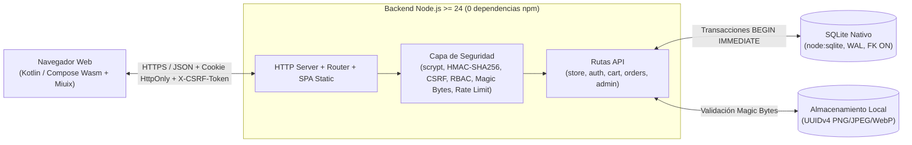

# TBD.SUPPLY

**Plataforma de Comercio Electrónico de Alto Rendimiento** — Solución web full-stack desarrollada con arquitectura nativa. Incorpora una interfaz de usuario reactiva compilada a **WebAssembly (Kotlin / Compose Multiplatform + Miuix UI)** y un servidor backend de alta seguridad en **Node.js (>= 24) + SQLite (WAL)**, diseñado íntegramente mediante módulos estándar del entorno de ejecución y sin dependencias externas de terceros.

[](https://github.com/MituOS2/mitu-supply/actions/workflows/ci.yml)
[](LICENSE)
[](https://nodejs.org/)
[](https://kotlinlang.org/docs/wasm-overview.html)
[](https://nodejs.org/api/sqlite.html)
[](#arquitectura-y-stack-técnico)

> Proyecto creativo de ingeniería desarrollado y mantenido por el **Equipo TBD.SUPPLY**.

---

## Tabla de Contenidos

- [¿Qué es TBD.SUPPLY?](#qué-es-tbdsupply)
  - [¿Qué se puede hacer en la aplicación?](#qué-se-puede-hacer-en-la-aplicación)
- [Características Principales](#características-principales)
  - [Experiencia de Tienda (Frontend WebAssembly)](#experiencia-de-tienda-frontend-webassembly)
  - [Panel de Administración y Operación](#panel-de-administración-y-operación)
- [Arquitectura y Stack Técnico](#arquitectura-y-stack-técnico)
  - [Flujo de Datos y Componentes](#flujo-de-datos-y-componentes)
- [Estructura del Proyecto](#estructura-del-proyecto)
- [Inicio Rápido (1 Clic)](#inicio-rápido-1-clic)
  - [Requisitos Previos](#requisitos-previos)
  - [Windows](#windows)
  - [Linux / macOS](#linux--macos)
- [Desarrollo Manual](#desarrollo-manual)
  - [Scripts npm Disponibles](#scripts-npm-disponibles)
- [Configuración y Variables de Entorno](#configuración-y-variables-de-entorno)
- [Referencia de la API REST](#referencia-de-la-api-rest)
  - [Tienda y Salud](#tienda-y-salud)
  - [Autenticación y Sesiones](#autenticación-y-sesiones)
  - [Carrito y Checkout](#carrito-y-checkout)
  - [Pedidos y Chat con Adjuntos](#pedidos-y-chat-con-adjuntos)
  - [Panel de Administración](#panel-de-administración-apiadmin---solo-rol-admin)
- [Esquema de Base de Datos](#esquema-de-base-de-datos)
- [Seguridad Implementada desde Cero](#seguridad-implementada-desde-cero)
- [Pruebas Automatizadas](#pruebas-automatizadas)
- [Solución de Problemas Frecuentes](#solución-de-problemas-frecuentes)
- [Contribución y Gobernanza](#contribución-y-gobernanza)
- [Equipo y Licencia](#equipo-y-licencia)

---

## ¿Qué es TBD.SUPPLY?

**TBD.SUPPLY** es una **tienda web en línea completa (*e-commerce*)** pensada para **publicar, administrar y vender objetos** de forma directa desde el navegador, combinando una experiencia visual fluida para compradores con un **panel de administrador integrado**.

### ¿Qué se puede hacer en la aplicación?

- **Comprar como cliente:**
  - Explorar el catálogo de objetos disponibles, buscar artículos por palabras clave, filtrarlos por categoría o por curador y ordenarlos por precio, novedad o stock disponible.
  - Abrir el detalle de cualquier producto para ver su galería interactiva de imágenes, descripción detallada, precio en **USD** y unidades disponibles.
  - Crear una cuenta personalizada, añadir artículos al **carrito de compras** (con fusión automática desde sesión invitada) y realizar pedidos con descuento automático de inventario y **recibo de confirmación** generado al instante.
  - Seguir el estado en tiempo real de cada orden y conversar directamente con el administrador desde el **chat integrado por pedido**, con soporte para enviar mensajes de texto y **subir imágenes** (comprobantes de pago o fotos de referencia).
- **Gestionar la tienda desde el Panel de Administrador:**
  - **Vender y publicar nuevos objetos** directamente desde la interfaz sin editar código ni la base de datos: definir título, subtítulo, descripción, categoría, precio normal, precio tachado/oferta y unidades en stock.
  - **Colocar y administrar imágenes** en cada producto (`PNG`, `JPEG` y `WebP`), gestionar su galería, elegir la foto principal de portada y eliminar imágenes obsoletas.
  - **Crear y editar categorías** con nombre, slug, descripción, color de acento hexadecimal y orden de preferencia.
  - **Controlar pedidos y atender clientes:** revisar compras recibidas, cambiar el estado del pedido (`Pendiente`, `Preparando`, `Enviado`, `Entregado` o `Cancelado`) y responder en el chat de cada pedido con texto o fotografías.
  - **Administrar usuarios y seguridad:** consultar cuentas registradas, cambiar roles (`customer` / `admin`), activar/desactivar cuentas, cerrar sesiones remotamente y auditar todas las acciones del sistema a través de los registros de `audit_logs`.

---

## Características Principales

### Experiencia de Tienda (Frontend WebAssembly)
- **Interfaz nativa con Miuix UI:** Renderizada mediante Kotlin / Compose Multiplatform (`wasmJs` + Skiko) utilizando el sistema de diseño [Miuix UI](https://github.com/compose-miuix-ui/miuix).
- **Diseño adaptable (Responsive):** Transición fluida entre barra inferior (`NavigationBar`, `< 840 dp`) para dispositivos móviles y riel lateral (`NavigationRail`, expandible en `>= 1180 dp`) para pantallas de escritorio.
- **Personalización visual en vivo:** Soporte nativo para 6 modos de color (`System`, `Light`, `Dark`, `MonetSystem`, `MonetLight`, `MonetDark`), paletas clave dinámicas y bordes suavizados *Squircle*.
- **Catálogo interactivo:** Búsqueda rápida con escape de caracteres especiales, filtrado por categorías y curadores, ordenamiento por precio/fecha/stock y visualizador de imágenes con zoom.
- **Carrito y Checkout en USD:** Carrito persistente indexado por usuario con fusión automática tras iniciar sesión (`/api/cart/merge`), cálculo exacto de subtotales en centavos enteros y recibo único con formato `TBD-YYYY-XXXXXX`.
- **Chat directo por pedido:** Hilo de mensajería bidireccional cliente-administrador asignado a cada orden, con soporte para mensajes de texto y adjuntos de imagen validados (`PNG`, `JPEG`, `WebP`).

### Panel de Administración y Operación
- **Dashboard con métricas en tiempo real:** Resumen gráfico y numérico del catálogo, unidades en inventario, ventas, volumen de pedidos y usuarios activos.
- **Gestión integral (CRUD):** Control de categorías, productos, galerías de imágenes, asignación de portadas principales, flujo de pedidos, gestión de cuentas de usuario y consulta de logs de auditoría.
- **Arranque desatendido y túnel público:** Instalador automático en 1 clic para Windows (`iniciar.bat`) y POSIX (`iniciar.sh`), con soporte opcional para exponer la aplicación a internet mediante **Cloudflare Quick Tunnel**.

---

## Arquitectura y Stack Técnico

### Flujo de Datos y Componentes



| Capa | Tecnología | Detalles |
| :--- | :--- | :--- |
| **Frontend** | Kotlin `2.4.21` + Compose Multiplatform `1.12.2` | Compilación `wasmJs` (`composeApp.js` + `.wasm`), `kotlinx-serialization` `1.13.0`, `kotlinx-collections-immutable` `0.5.2` |
| **Sistema de Diseño** | [Miuix UI](https://github.com/compose-miuix-ui/miuix) (`compose-miuix-ui`) | Integrado mediante Gradle composite build en `vendor/miuix` (pin `d8efe187`) |
| **Backend** | Node.js `>= 24.0.0` (ESM) | Módulos nativos (`node:http`, `node:sqlite`, `node:crypto`, `node:fs`, `node:path`, `node:zlib`) — **cero paquetes npm de terceros** |
| **Base de Datos** | SQLite (`node:sqlite` `DatabaseSync`) | Modo `WAL`, `PRAGMA foreign_keys = ON`, `busy_timeout = 5000`, `BEGIN IMMEDIATE` en checkout |
| **Pruebas** | `node:test` + `node:assert/strict` | Suites automatizadas de integración end-to-end y auditoría de seguridad OWASP |
| **CI/CD** | GitHub Actions | Pipeline de integración continua automatizado en cada push/PR a `main` |

---

## Estructura del Proyecto

```text
TBD-Supply/
├── .github/
│   ├── ISSUE_TEMPLATE/          # Formularios YAML para bugs y propuestas
│   ├── workflows/ci.yml         # Pipeline CI de pruebas de integración y seguridad
│   └── PULL_REQUEST_TEMPLATE.md # Checklist estándar para Pull Requests
├── gradle/
│   ├── libs.versions.toml       # Catálogo centralizado de versiones Kotlin/Compose
│   └── wrapper/                 # Gradle Wrapper ejecutable
├── scripts/
│   ├── bootstrap.ps1            # Instalador, compilador Wasm y lanzador Windows
│   ├── bootstrap.sh             # Instalador, compilador Wasm y lanzador Linux/macOS
│   └── seed-assets/             # Imágenes PNG semilla para el catálogo demo
├── server/
│   ├── src/
│   │   ├── db/                  # Conexión SQLite WAL, migraciones, semilla y assets PNG
│   │   ├── http/                # Enrutador propio y helpers de E/S HTTP seguros
│   │   ├── middleware/          # Sesión, CSRF/Same-Origin y control RBAC
│   │   ├── routes/              # Rutas REST (store, auth, cart, orders, admin)
│   │   ├── security/            # scrypt, sesiones, CSRF, cabeceras, upload, rate limit
│   │   ├── utils/               # Auditoría persistente (audit_logs) y hash de IP
│   │   ├── app.js               # Ensamblado HTTP, API y servicio de estáticos SPA
│   │   ├── config.js            # Carga de variables de entorno .env y parámetros
│   │   └── index.js             # Arranque del servidor y cierre limpio (SIGINT/SIGTERM)
│   ├── tests/
│   │   ├── integration.test.js  # Flujo integral de tienda, checkout y panel admin
│   │   └── security.test.js     # Auditoría automatizada contra vectores OWASP
│   └── dist-web/                # Paquete WebAssembly compilado servido por Node.js
├── webApp/
│   └── src/
│       ├── commonMain/kotlin/nose/
│       │   ├── model/           # DTOs serializables y formateo de precios USD
│       │   ├── network/         # Cliente API HTTP y puente de plataforma
│       │   ├── state/           # Estado reactivo global de la tienda (StoreAppState)
│       │   ├── ui/components/   # Componentes Miuix, tarjetas, recibos y chat
│       │   ├── ui/screens/      # Pantallas de Tienda, Categorías, Carrito, Cuenta y Admin
│       │   └── App.kt           # Punto de entrada Compose + navegación adaptable
│       └── webMain/             # Bootstrap WebAssembly, puente JS y recursos estáticos
├── .editorconfig                # Reglas de formato multi-IDE
├── .env.example                 # Plantilla de variables de entorno
├── AGENTS.md                    # Guía y pautas para agentes de Inteligencia Artificial
├── CHANGELOG.md                 # Registro de versiones (Keep a Changelog)
├── CONTRIBUTING.md              # Guía de contribución y Conventional Commits
├── LICENSE                      # Licencia de software MIT
├── SECURITY.md                  # Política de seguridad y guía de endurecimiento
├── iniciar.bat                  # Lanzador automático de 1 clic para Windows
├── iniciar-publico.bat          # Lanzador Windows + Cloudflare Quick Tunnel
└── iniciar.sh                   # Lanzador automático de 1 clic para Linux / macOS
```

---

## Inicio Rápido (1 Clic)

### Requisitos Previos
Los scripts de arranque detectan e instalan automáticamente las dependencias faltantes cuando es posible. Los requisitos del sistema son:
- **Node.js `>= 24.0.0`** (con soporte nativo para `node:sqlite`)
- **JDK `21+`** (para compilar el frontend Kotlin/Compose Wasm con Gradle)
- **Git** (para clonar el módulo del sistema de diseño Miuix)

### Windows
Haz doble clic en **`iniciar.bat`** o ejecútalo desde tu terminal:

```bat
iniciar.bat
```

El lanzador automático realiza las siguientes acciones:
1. Verifica **Node.js (>= 24)**, **npm**, **JDK 21+** y **Git**. Si falta alguno, solicita elevación UAC para instalarlo automáticamente vía `winget` o descarga oficial verificada por SHA-256.
2. Inicializa `vendor/miuix` clonando la librería Miuix en el commit verificado (`d8efe187`).
3. Genera un archivo `.env` seguro desde `.env.example` con claves criptográficas únicas (`SESSION_PEPPER` e `IP_HASH_SALT`).
4. Compila el frontend WebAssembly en `server/dist-web/` y guarda un hash de compilación (`.build-stamp`) para arranques posteriores ultrarrápidos.
5. Ejecuta migraciones SQLite, configura la cuenta del administrador inicial, aguarda la respuesta en `/api/health` y abre el navegador automáticamente en `http://127.0.0.1:3000`.

| Comando / Parámetro | Descripción |
| :--- | :--- |
| `iniciar-publico.bat` *(o `iniciar.bat -Tunnel`)* | Levanta el servidor local y genera un enlace público temporal con **Cloudflare Quick Tunnel** (`https://*.trycloudflare.com`). |
| `iniciar.bat -Rebuild` | Fuerza la recompilación limpia del frontend WebAssembly. |
| `iniciar.bat -BuildOnly` | Compila el frontend WebAssembly y finaliza sin iniciar el servidor HTTP. |
| `iniciar.bat -CheckOnly` | Verifica únicamente si Node.js, Java y las herramientas están correctamente instaladas. |
| `iniciar.bat -NoBrowser` | Inicia el servidor sin abrir la ventana del navegador automáticamente. |

### Linux / macOS
Asigna permisos de ejecución y ejecuta el instalador POSIX:

```bash
chmod +x iniciar.sh scripts/bootstrap.sh
./iniciar.sh
```

Opciones disponibles en POSIX:
- `./iniciar.sh --rebuild` — fuerza la recompilación limpia del frontend WebAssembly.
- `./iniciar.sh --build-only` — compila el frontend y finaliza sin iniciar el servidor.
- `./iniciar.sh --no-browser` — levanta el servidor sin abrir el navegador predeterminado.
- `./iniciar.sh --tunnel` — habilita el túnel público temporal con `cloudflared`.

---

## Desarrollo Manual

Si prefieres controlar cada paso del entorno desde la terminal sin utilizar los instaladores de 1 clic:

```bash
# 1. Copiar y configurar las variables de entorno
cp .env.example .env

# 2. Inicializar la base de datos SQLite y poblar datos semilla
npm run seed

# 3. Compilar el frontend WebAssembly (requiere Java 21+ y vendor/miuix)
./gradlew :webApp:wasmJsBrowserDistribution -Prelease --no-configure-on-demand
cp -R webApp/build/dist/wasmJs/productionExecutable/. server/dist-web/

# 4. Iniciar el servidor backend en modo desarrollo con recarga automática
npm run dev
```

### Scripts `npm` Disponibles

| Script | Comando | Descripción |
| :--- | :--- | :--- |
| `npm start` | `node server/src/index.js` | Inicia el servidor HTTP en modo producción/estándar. |
| `npm run dev` | `node --watch server/src/index.js` | Inicia el servidor con reinicio automático ante cambios en el código backend. |
| `npm run seed` | `node server/src/db/runSeed.js` | Aplica migraciones SQLite y configura el catálogo demo y administrador inicial. |
| `npm test` | `node --test server/tests/integration.test.js server/tests/security.test.js` | Ejecuta la suite completa de pruebas de integración y seguridad. |
| `npm run test:security` | `node --test server/tests/security.test.js` | Ejecuta exclusivamente la batería de pruebas de auditoría de seguridad. |

---

## Configuración y Variables de Entorno

El servidor lee las variables de entorno desde el archivo `.env` o desde las variables del sistema operativo:

| Variable | Valor por Defecto | Descripción |
| :--- | :--- | :--- |
| `PORT` | `3000` | Puerto de escucha para el servidor HTTP (`1–65535`). |
| `HOST` | `127.0.0.1` | Dirección IP de escucha del servidor. |
| `NODE_ENV` | `development` | Entorno de ejecución (`development` / `production`). |
| `DB_PATH` | `server/data/store.sqlite` | Ruta del archivo de base de datos SQLite. |
| `UPLOAD_DIR` | `server/storage/uploads` | Carpeta de almacenamiento local para imágenes de productos y chats. |
| `DIST_WEB_DIR` | `server/dist-web` | Directorio con los archivos WebAssembly estáticos servidos por Node.js. |
| `SESSION_PEPPER` | *(autogenerado)* | Secreto HMAC-SHA256 de 32 bytes hex para hashear tokens de sesión opacos. |
| `IP_HASH_SALT` | *(autogenerado)* | Sal criptográfica para anonimizar direcciones IP en registros de auditoría y rate limit. |
| `ADMIN_BOOTSTRAP_USER` | `admin` | Usuario inicial para la cuenta del panel de administración. |
| `ADMIN_BOOTSTRAP_EMAIL` | `admin@tbdsupply.local` | Correo electrónico inicial del usuario administrador. |
| `ADMIN_BOOTSTRAP_PASSWORD` | *(cadena aleatoria)* | Contraseña del admin inicial. Si no se indica, se genera una de 20 caracteres. |
| `ALLOWED_ORIGINS` | `""` | Dominios permitidos adicionales separados por comas para validación CSRF. |
| `TRUST_PROXY` | `false` | Activar (`true`) únicamente cuando se ejecuta detrás de un Reverse Proxy confiable. |
| `COOKIE_SECURE` | `false` (`true` en `production`) | Exige el atributo `Secure` en cookies de sesión sobre HTTPS. |
| `LOCAL_AUTO_ADMIN` | `true` | Inicia sesión admin de forma automática en peticiones directas desde `127.0.0.1`. **Desactivar en producción.** |
| `SEED_DEMO_CATALOG` | `false` | Carga automáticamente el catálogo demo de 4 categorías y 12 productos con imágenes. |

---

## Referencia de la API REST

Todas las peticiones mutativas (`POST`, `PUT`, `PATCH`, `DELETE`) verifican los encabezados de origen y, al tener una sesión activa, exigen la cabecera `X-CSRF-Token`.

### Tienda y Salud
| Método | Ruta | Acceso | Descripción |
| :--- | :--- | :--- | :--- |
| `GET` | `/api/health` | Público | Estado operativo de la API (`{ "ok": true }`). |
| `GET` | `/api/categories` | Público | Lista de categorías activas con recuento de productos. |
| `GET` | `/api/products` | Público | Catálogo con filtros de búsqueda (`q`, `category`, `founder`, `sort`, `page`, `limit`). |
| `GET` | `/api/products/:slug` | Público | Información detallada de un producto y su galería de fotos. |
| `GET` | `/api/media/:key` | Público | Entrega segura de imágenes de productos validadas con sandbox CSP. |

### Autenticación y Sesiones
| Método | Ruta | Acceso | Descripción |
| :--- | :--- | :--- | :--- |
| `GET` | `/api/auth/me` | Público | Devuelve la información del usuario autenticado y su `csrfToken`. |
| `POST` | `/api/auth/register` | Público | Registro de cuenta de cliente e inicio de sesión automático. |
| `POST` | `/api/auth/login` | Público | Autenticación con usuario/correo y contraseña (protegido contra fuerza bruta). |
| `POST` | `/api/auth/logout` | Autenticado | Revoca la sesión activa y elimina la cookie de sesión `tbd_sid`. |
| `POST` | `/api/auth/logout-all` | Autenticado | Revoca todas las sesiones activas asociadas al usuario. |
| `POST` | `/api/auth/change-password` | Autenticado | Actualiza la contraseña del usuario y revoca las sesiones previas. |

### Carrito y Checkout
| Método | Ruta | Acceso | Descripción |
| :--- | :--- | :--- | :--- |
| `GET` | `/api/cart` | Autenticado | Obtiene el carrito actual del usuario con subtotal y estado de inventario. |
| `PUT` | `/api/cart/items/:productId` | Autenticado | Ajusta la cantidad de un producto (`0` elimina, `1–99` valida stock). |
| `POST` | `/api/cart/merge` | Autenticado | Fusiona los ítems de un carrito invitado en la cuenta del usuario. |
| `POST` | `/api/checkout` | Autenticado | Procesa la orden y descuenta el stock de forma atómica (`BEGIN IMMEDIATE`). |

### Pedidos y Chat con Adjuntos
| Método | Ruta | Acceso | Descripción |
| :--- | :--- | :--- | :--- |
| `GET` | `/api/orders` | Autenticado | Historial completo de compras realizadas por el usuario. |
| `GET` | `/api/orders/:orderCode` | Propietario / Admin | Detalle del pedido, productos comprados e historial de mensajería. |
| `GET` | `/api/orders/:orderCode/messages` | Propietario / Admin | Lista los mensajes del chat del pedido. |
| `POST` | `/api/orders/:orderCode/messages` | Propietario / Admin | Envía mensaje de texto (`json`) o texto con adjunto de imagen (`multipart`). |
| `GET` | `/api/orders/:orderCode/attachments/:key` | Propietario / Admin | Descarga segura de imágenes adjuntas en el chat con control anti-IDOR. |

### Panel de Administración (`/api/admin/*` — Solo rol `admin`)
| Recurso | Endpoints |
| :--- | :--- |
| **Dashboard** | `GET /api/admin/dashboard` |
| **Categorías** | `GET /api/admin/categories`, `POST /api/admin/categories`, `PATCH /api/admin/categories/:id`, `DELETE /api/admin/categories/:id` |
| **Productos** | `GET /api/admin/products`, `POST /api/admin/products`, `PATCH /api/admin/products/:id`, `DELETE /api/admin/products/:id` |
| **Imágenes** | `POST /api/admin/media`, `PATCH /api/admin/media/:id/primary`, `DELETE /api/admin/media/:id` |
| **Pedidos** | `GET /api/admin/orders`, `PATCH /api/admin/orders/:id/status`, `DELETE /api/admin/orders/:id` |
| **Usuarios** | `GET /api/admin/users`, `PATCH /api/admin/users/:id`, `POST /api/admin/users/:id/revoke-sessions`, `DELETE /api/admin/users/:id` |
| **Auditoría** | `GET /api/admin/audit-logs`, `POST /api/admin/reset-db` |

---

## Esquema de Base de Datos

SQLite opera en modo `WAL` con verificación estricta de llaves foráneas (`PRAGMA foreign_keys = ON`) y 10 tablas relacionales definidas en [`server/src/db/migrations.js`](server/src/db/migrations.js):

- **`users`**: Registra usuarios (`customer` / `admin`), hashes derivados con `scrypt`, estado activo/bloqueado y versión de sesión.
- **`sessions`**: Almacena hashes HMAC-SHA256 de los tokens de sesión, token CSRF, IP anonimizada y expiraciones.
- **`categories`**: Categorías con slug único, acento de color en formato hexadecimal y orden numérico.
- **`products`**: Productos del catálogo con tag de curador, precio y precio de oferta en centavos USD (`price_cents > 0`) y unidades en stock (`stock >= 0`).
- **`product_images`**: Galería de fotos (`storage_key`, `mime_type`, `byte_size`, `sha256`, indicador de portada `is_primary`).
- **`cart_items`**: Carritos de compras con restricción única `(user_id, product_id)` y cantidades limitadas (`1–99`).
- **`orders` y `order_items`**: Pedidos procesados con código único (`TBD-YYYY-XXXXXX`), estados y snapshot inmutable del precio al momento de la compra.
- **`order_messages`**: Mensajería directa en cada pedido con texto y soporte para archivos de imagen adjuntos.
- **`audit_logs`**: Registro histórico inmutable de eventos del sistema (autenticación, cambios de clave, gestión de catálogo y acciones administrativas).

---

## Seguridad Implementada desde Cero

Para conocer los detalles completos de arquitectura y endurecimiento en entornos de producción, consulta [`SECURITY.md`](SECURITY.md). Resumen de protecciones defensivas:

- **Contraseñas:** Derivación con `crypto.scrypt` (`N=16384`, `r=8`, `p=1`, 64 bytes), sal aleatoria de 16 bytes, comparación en tiempo constante (`crypto.timingSafeEqual`) y hash ficticio para mitigar ataques de enumeración por tiempo.
- **Sesiones Opacas:** Tokens aleatorios de 256 bits enviados mediante la cookie `tbd_sid` (`HttpOnly; SameSite=Strict`). La base de datos almacena exclusivamente la firma `HMAC-SHA256(token, SESSION_PEPPER)`.
- **Protección Anti-CSRF:** Verificación cruzada de `Sec-Fetch-Site` / `Origin` / `Referer` junto con la cabecera obligatoria `X-CSRF-Token` vinculada a la sesión activa.
- **Control de Acceso (RBAC) y Anti-IDOR:** Validación de permisos contra la base de datos en cada llamada API. El acceso a pedidos, carritos, chats y archivos está estrictamente aislado por usuario.
- **Subida de Archivos Protegida:** Parser multipart propio blindado contra *Prototype Pollution* (`Object.create(null)`), validación binaria por **Magic Bytes** (`PNG`, `JPEG`, `WebP`), **bloqueo estricto de SVG** contra Stored XSS, límite de 3 MB por archivo, renombre a `UUIDv4` y cabeceras de seguridad `Content-Security-Policy: default-src 'none'; sandbox` + `X-Content-Type-Options: nosniff`.
- **Garantía de Inventario:** Transacciones SQLite con aislamiento `BEGIN IMMEDIATE` y descuento condicional de stock para prevenir la venta excesiva en entornos concurrentes.
- **Defensa ante Abuso:** Rate limiter por ventana deslizante, bloqueo automático de 10 minutos tras 5 intentos fallidos de inicio de sesión, timeouts HTTP estrictos y trazabilidad en `audit_logs`.

---

## Pruebas Automatizadas

```bash
# Ejecutar todas las pruebas (integración + auditoría de seguridad OWASP)
npm test

# Ejecutar únicamente las pruebas de seguridad
npm run test:security
```

Las pruebas se ejecutan de manera aislada sobre un entorno temporal y una base de datos SQLite dedicada, cubriendo:
- **Pruebas de Integración (`server/tests/integration.test.js`):** Salud del servidor, entrega de medios PNG, flujos de registro, inicio de sesión, manipulación de carrito, checkout atómico y operaciones completas del panel de administración.
- **Pruebas de Seguridad (`server/tests/security.test.js`):** Inyección SQL en parámetros de catálogo, verificación de firmas de sesión, pruebas CSRF (origen no permitido, token inválido), escalada de privilegios RBAC, IDOR en adjuntos y pedidos, rechazo de archivos SVG (Stored XSS), Path Traversal en medios, mitigación de Prototype Pollution, bloqueo por fuerza bruta y condiciones de carrera (*Race Conditions*) en inventario concurrente.

---

## Solución de Problemas Frecuentes

### 1. Error: `node:sqlite` no se encuentra o la versión de Node es incompatible
**Solución:** Asegúrate de tener instalado **Node.js >= 24.0.0**. Puedes verificar tu versión ejecutando `node -v` en la terminal.

### 2. Error al compilar Miuix o falta el directorio `./vendor/miuix`
**Solución:** Ejecuta `iniciar.bat` (en Windows) o `./iniciar.sh` (en Linux/macOS). El script clonará e inicialización automáticamente la librería Miuix en el commit verificado.

### 3. Error de compilación en Gradle (`JDK 21 required`)
**Solución:** Verifica que tu variable de entorno `JAVA_HOME` apunte a una instalación válida de **JDK 21** o superior.

### 4. Conflicto de puertos (`PORT 3000 in use`)
**Solución:** Modifica la variable `PORT` en tu archivo `.env` a un puerto libre (por ejemplo `PORT=3001`) y reinicia la aplicación.

---

## Contribución y Gobernanza

- Revisa la guía en [`CONTRIBUTING.md`](CONTRIBUTING.md) para conocer las pautas de desarrollo y el formato **Conventional Commits**.
- Consulta [`SECURITY.md`](SECURITY.md) para políticas de divulgación de vulnerabilidades y buenas prácticas de producción.
- Consulta [`AGENTS.md`](AGENTS.md) si eres una Inteligencia Artificial trabajando en este repositorio.
- Consulta [`CHANGELOG.md`](CHANGELOG.md) para ver el historial de cambios por versión.

---

## Equipo y Licencia

Desarrollado y mantenido por el **Equipo TBD.SUPPLY**.

Proyecto distribuido bajo la licencia libre **MIT**. Para más detalles, consulta el archivo [`LICENSE`](LICENSE).
